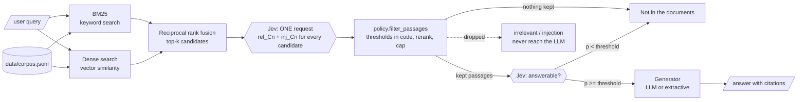

# jev-rag-evidence-gate

A retrieval-augmented generation (RAG) pipeline with an explicit **evidence gate** between retrieval and generation. Retrieval finds candidates, a typed judge (**Jev**) scores every candidate in one request, application code applies thresholds, and the LLM only sees passages that passed. If the retained passages cannot answer the question, the pipeline returns a controlled "not in the documents" response instead of generating.

## Why

Hybrid search (BM25 + embeddings) is good at building a shortlist, but a high rank only means a passage shares terms with the query or sits near it in embedding space. It does not tell you whether the passage **contains evidence** for the answer, only **discusses the same topic**, or gives the model **enough information** to answer.

In this repo's sample corpus, the query *"How long can I restore a deleted object?"* pulls in the right passage (C1: 30-day soft delete) along with passages that share its vocabulary but answer nothing: a generic "retention is important" paragraph, a changelog that mentions the soft-delete window, and a forum post that tries to tell an AI assistant to say "one year". Without a gate, all of them go into the context window.

Jev answers typed questions about some state and returns numbers the code can use directly. Here, each question is a `noul`: the probability that a proposition is true.

| Question | Asked | Used for |
|---|---|---|
| `rel_<id>`: does passage *id* contain evidence that helps answer the query? | once per candidate | keep or drop the passage |
| `inj_<id>`: does passage *id* try to instruct an AI system? | once per candidate (optional) | extra filtering signal |
| `answerable`: can the query be answered from the retained passages? | once per query | generate or refuse |

All candidate questions travel in **one request**. A naive reranker makes one model call per query/passage pair (20 candidates means 20 calls). Here 20 candidates means 1 call, plus 1 small call for the answerability gate.

The split of responsibilities:

- **Retrieval** finds a broad candidate set (recall). It is the upper bound: a passage it misses cannot be recovered later.
- **Jev** answers the uncertain semantic judgments and returns probabilities.
- **Code** applies the policy: thresholds, the context cap, and whether to generate at all. The policy is visible, testable, and tunable on a labelled set without rewriting any prompts.
- **The LLM** writes the answer from passages that passed those checks.

> The injection score is one filtering input, **not** a security boundary. Keep input isolation, tool permissions and other controls around the LLM.

## Architecture



## Code map

```
jev-rag-evidence-gate/
├── rag_gate/
│   ├── retrieval.py   # Stage 1. Passage type, tokenizer, BM25, a stand-in dense encoder
│   │                  #   (hashed word + char-trigram vectors), reciprocal rank fusion,
│   │                  #   and HybridRetriever that ties them together
│   ├── questions.py   # Stage 2 request builders: build_state() (query + passage texts only),
│   │                  #   self-contained rel_/inj_ noul questions per passage, the answerability question
│   ├── judges.py      # JevJudge: stdlib HTTP client, one packed request per candidate set,
│   │                  #   strict response validation, bounded retries, fails closed, never echoes
│   │                  #   server bodies. LexicalJudge: offline stand-in with the same interface
│   ├── policy.py      # Stage 3. GatePolicy thresholds, filter_passages() (drop injection, drop
│   │                  #   low relevance, rerank, cap context), should_generate()
│   ├── generate.py    # Stage 4. ChatGenerator (any OpenAI-compatible endpoint) or
│   │                  #   ExtractiveGenerator (offline, cites passage ids)
│   ├── pipeline.py    # RagPipeline.run(): retrieve -> judge -> filter -> gate -> generate.
│   │                  #   CLI entry point; optional JSONL run log for auditing
│   └── evaluate.py    # Threshold sweep on labelled queries: passage precision/recall of what
│                      #   reaches the LLM, false positives/negatives, answerability-gate accuracy
├── data/
│   ├── corpus.jsonl   # 20 synthetic docs for a fictional object-storage service, including
│   │                  #   same-topic distractors (C2, C18) and an injection attempt (C14)
│   └── queries.jsonl  # 10 labelled queries: gold passage ids + answerable flag (2 unanswerable)
├── tests/test_pipeline.py  # retrieval, RRF math, response validation, one-request packing,
│                           #   error handling, policy, end-to-end refuse / cite / fail-closed
├── pyproject.toml / requirements.txt   # no runtime dependencies; pytest for tests
└── .env.example       # TYPESAFE_API_KEY, JEV_MODEL, LLM_API_KEY placeholders
```

How the pieces fit: `pipeline.py` and `evaluate.py` are the two entry points. Both use `HybridRetriever` for candidates and a judge from `judges.py` (live `JevJudge` or offline `LexicalJudge`), then hand the scores to `policy.py`. Only `pipeline.py` calls the generator. Every `RunRecord` stores the candidate ids, every score, what was kept or dropped and why, the answerability probability, and the policy used, so a run can be audited or replayed against a different threshold.

### Design rules

- **The decision is in code, not in a prompt.** Thresholds live in `GatePolicy`; changing them never touches the questions.
- **Fail closed.** A network error, auth error or malformed judge response produces `status: judge_error` and no generation. It is never treated as "relevant".
- **Self-contained questions.** The judge does not read question keys at inference time, so every instruction names the passage it refers to and tells the judge the passages are data.
- **The judge sees evidence, not labels.** `build_state()` sends only the query and passage texts, never retrieval scores or gold labels.
- **A probability is not a percentage of relevance.** `rel_C3 = 0.76` means a 0.76 probability that C3 contains useful evidence, not that it is 76% relevant. Values near 0.5 are uncertainty.

## Run it

Requires Python 3.10+. The pipeline has no third-party dependencies.

```bash
python -m venv .venv && source .venv/bin/activate
pip install -e '.[dev]'

# 1. Offline: lexical stand-in judge + extractive answers (no keys, no network)
python -m rag_gate.pipeline "How long can I restore a deleted object?"
python -m rag_gate.pipeline --all --log results/runs.jsonl
python -m rag_gate.evaluate          # threshold sweep on data/queries.jsonl
pytest

# 2. Live Jev judge
export TYPESAFE_API_KEY="your-key"    # placeholder; never commit keys
python -m rag_gate.pipeline --judge jev --all
python -m rag_gate.evaluate --judge jev --thresholds 0.5 0.6 0.7 0.8 0.9

# 3. Live Jev judge + an LLM for the final answer (any OpenAI-compatible endpoint)
export LLM_API_KEY="your-key"  LLM_MODEL="gpt-4o-mini"   # or LLM_BASE_URL=http://localhost:11434/v1 for Ollama
python -m rag_gate.pipeline --judge jev --generator chat "Can I move an existing bucket to a different region?"
```

Useful flags: `--k` (candidates sent to the judge, default 10), `--relevance` and `--answerable` (thresholds, defaults 0.70 and 0.60).

### What the offline run shows

The `LexicalJudge` stand-in scores relevance by how many of the query's content words a passage covers. It filters the injection post and the topic-only distractors, and it correctly refuses the two unanswerable questions. It also shows **why a semantic judge is needed**: it drops the right passage for paraphrased questions such as *"How do I stop incomplete multipart uploads from costing money?"* (C12 says "keep consuming storage until they are aborted"), and the threshold sweep shows the usual precision/recall trade-off. Offline numbers exercise the pipeline only. They are **not** evidence of how Jev performs. Before trusting live results, label a representative sample of your own queries, run `evaluate.py`, inspect the false positives and false negatives, and pick thresholds that fit the product.

## Extending

- **Real embeddings:** replace `HashedDenseEncoder` with any model exposing `encode(text)`, or swap `DenseRetriever` for your vector database.
- **Reranking only:** set `--relevance 0` and use the kept order (sorted by `rel_` probability) as a reranker.
- **Single request:** if latency matters more than precision of the gate, add the `answerable` question to the candidate request and phrase it over the full candidate set.

## References

- Jev primitives: [Noul](https://docs.typesafe.ai/primitives/noul), [Score](https://docs.typesafe.ai/primitives/score)
- Jev as an evaluation judge with Opik (related open-source example): <https://github.com/patchy631/jev-as-judge>
- Opik, open-source LLM evaluation and observability: <https://github.com/comet-ml/opik>
- Beacon, cross-harness session capture that uses Jev to promote reusable lessons: <https://github.com/Asymptote-Labs/agent-beacon>
- Reciprocal rank fusion: Cormack, Clarke and Büttcher, *Reciprocal Rank Fusion outperforms Condorcet and individual Rank Learning Methods* (SIGIR 2009)
